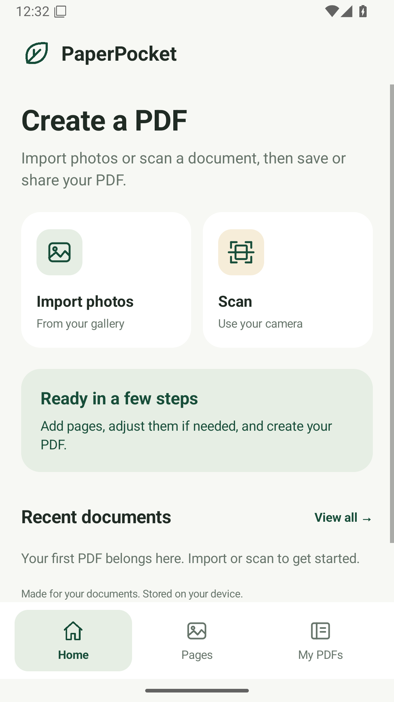
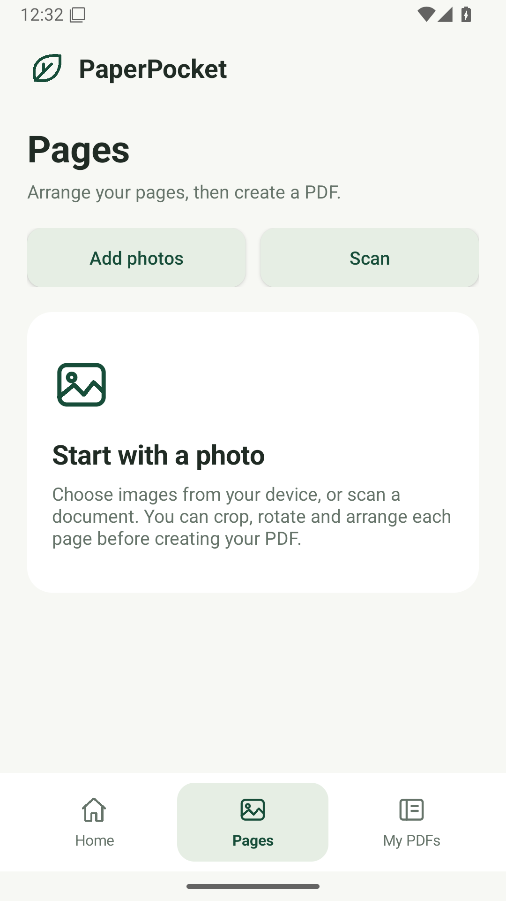
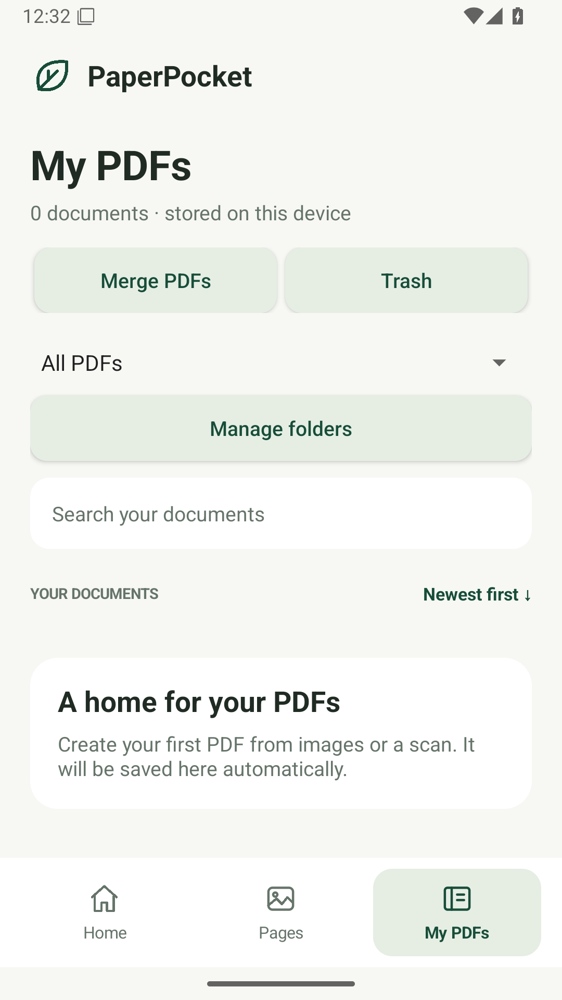

# PaperPocket — image to PDF for Android

A native Android app for importing images, scanning documents, arranging pages,
creating PDFs, and managing a private document library. The free beta is being
improved with phone feedback; see [ROADMAP.md](ROADMAP.md).

Source repository: [murtazaofficialskardu-cloud/PaperPocket](https://github.com/murtazaofficialskardu-cloud/PaperPocket).

## Beta downloads and delivery status

Version **1.3.0**, version code **4**, is a free GitHub beta for phone feedback.
Production Play Store launch is postponed. iOS and a hosted website have not been built.

- [Install/update Android APK](https://github.com/murtazaofficialskardu-cloud/PaperPocket/raw/refs/heads/main/downloads/PaperPocket-1.3.0.apk)
- [Signed AAB](https://github.com/murtazaofficialskardu-cloud/PaperPocket/raw/refs/heads/main/downloads/PaperPocket-1.3.0.aab)
- [Source ZIP](https://github.com/murtazaofficialskardu-cloud/PaperPocket/raw/refs/heads/main/downloads/PaperPocket-1.3.0-source.zip)
- [Listing and artwork kit](https://github.com/murtazaofficialskardu-cloud/PaperPocket/raw/refs/heads/main/downloads/PaperPocket-1.3.0-store-kit.zip)

The APK keeps the existing signing certificate and application ID so testers
can update without uninstalling. Build, native test, signing, and artifact
evidence for this version is recorded in [VALIDATION.md](VALIDATION.md).
Physical-phone acceptance remains a separate check.

The supplied installer screenshot says Play Protect has not seen an app from
this developer before. Valid signing does not clear this unfamiliar developer
warning. Its classification is recorded in
[TESTING_AND_SECURITY.md](TESTING_AND_SECURITY.md); warning investigation is
paused at the owner's request. No Google approval or warning removal is claimed.
Real-phone scan/camera checks remain to be completed.

## Features

- Import multiple images through the Android document picker, up to 100 pages.
- Scan using Google's document scanner with automatic edge detection,
  straightening, and cleanup on supported Google Play services devices.
- Full-resolution system-camera fallback when the scanner is unavailable.
- Reorder, remove, rotate, and perspective-crop pages. Choose original color,
  enhanced clarity, or black-and-white treatment.
- Create PDFs with Balanced (default, 200 DPI target), Compact (150 DPI), or High
  (300 DPI), with A4, Letter, or image-proportional paper and optional margins.
- Continue normal and ID-card PDF creation while the app is minimized; see
  photo progress, cancel before saving, and check the saved completion result.
  Optional notifications show progress/completion outside the app.
- Create a one-page A4 ID-card PDF from exactly two images, front then back.
  Crop close to the card edges first; images fit without stretching.
- Reduce a saved PDF's file size; keep its original, save only a smaller copy,
  and see actual before/after sizes. Copies flatten PDF content into page images.
- See page progress and cancel imports, conversion, compression, merging,
  page extraction, and text recognition before their final save.
- Merge supported PaperPocket PDFs in a chosen order, or extract selected pages
  such as `1,3-5`. Page dimensions and embedded JPEGs stay unchanged; sources remain.
- Extract printed Latin/English text locally with a bundled model; Copy, Share
  a TXT file, or Save TXT. Up to 50 pages per text-extraction job.
- Centered Home / Pages / My PDFs navigation and simpler creation options.
- List every PDF generated by the app; search, sort, rename, move to Trash,
  Undo/Restore across restarts, and confirm permanent deletion.
- Organize generated PDFs into folders and Favorites. Deleting a folder keeps
  its PDFs in All PDFs; moving a PDF between folders does not duplicate it.
- View PDFs inside the app with page navigation, zoom, and pan.
- Share PDFs through Android's share sheet and save copies to a chosen location.
- Restore drafts and the private PDF library after restarting the app.

The universal beta APK includes the bundled OCR model and supported CPU
architectures, so no OCR model download is needed. Exact artifact sizes are in
[VALIDATION.md](VALIDATION.md). A later Play bundle can deliver only the device's
architecture.

High quality preserves the available source detail; it cannot recover a blurred
or low-resolution photograph. Text extraction returns text separately; the
PDF remains image-based without a searchable text layer. Urdu/handwriting OCR
and arbitrary external PDF import are not implemented. Merge/extraction support
the app's known image-PDF format and reject unsupported formats clearly.
The library lists PDFs made by PaperPocket, not every PDF on the device.

Background completion applies to normal and ID-card PDF creation. One PDF is
created at a time, with draft edits locked until it finishes or is canceled.
Import, compression, merge, page extraction, and OCR still use their in-app
processing flow. Force-stop, reboot, or Android terminating the process can
interrupt a job; it does not restart automatically. Reopen the app to check the
result and retry from the retained draft if needed.

## Use the new tools

- **Background creation:** choose Create PDF in Pages, then continue using the
  phone. On Android 13+, notification permission is optional; declining still
  allows conversion and the in-app progress/result banner.
- **Folders and Favorites:** open a PDF's actions in My PDFs to add a Favorite or
  Move to folder. Use Manage folders to create, rename, or delete a folder, and
  the library filter to view its contents.
- **ID-card PDF:** keep exactly two draft photos, front first and back second.
  Crop/rotate them, choose Create ID-card PDF, then choose a name and quality.
  Both sides appear on one portrait A4 page in standard card-size frames.

## Native beta UI previews

These are unedited screenshots captured from the installed Android emulator app.

  

## Requirements

- Android 8.0 / API 26 or newer; compilation targets Android 16 / API 36.
- Android Studio with Android SDK Platform 36 and Build Tools 36.0.0.
- JDK 17, Gradle 8.13, Android Gradle Plugin 8.13.2.
- Internet for the initial dependency downloads and, on supported devices, the
  scanner's initial component download. Import, conversion, viewing, and the
  private library and bundled text recognition operate locally after installation.

PaperPocket does not request broad storage or camera access. It uses Android
document pickers and a system camera activity. Generated PDFs and drafts live
inside private app storage. Android 13+ may ask for optional conversion
notifications. A foreground service and a bounded CPU wake lock support a
conversion started by the user; neither grants access to photos or documents.
Export important PDFs before clearing app data or
uninstalling; backup is disabled for private documents.

## Build in Android Studio

1. Open the `PaperPocket` folder as an Android project.
2. In SDK Manager install **Android SDK Platform 36** and **Build Tools 36.0.0**.
3. In Gradle settings choose a JDK 17 installation and the project's
   **Gradle wrapper**. The standard wrapper JAR, properties, and launchers are
   included; they select Gradle 8.13 automatically.
4. Allow Gradle sync to fetch dependencies from Google Maven and Maven Central.
5. Select a connected device or emulator and press **Run**.

Android Studio normally writes `local.properties` with the SDK path. That file
is machine-specific and ignored by Git.

## Build from the terminal

Install JDK 17 and the Android SDK, and set `JAVA_HOME` and `ANDROID_HOME` for
your machine. Alternatively create an ignored `local.properties` file containing
`sdk.dir=/absolute/path/to/Android/Sdk` (escape Windows backslashes or use `/`).

Linux/macOS:

```sh
chmod +x gradlew
./gradlew --no-daemon :app:assembleDebug :app:testDebugUnitTest :app:lintDebug
```

Windows PowerShell or Command Prompt:

```powershell
.\gradlew.bat --no-daemon :app:assembleDebug :app:testDebugUnitTest :app:lintDebug
```

The checked-in standard Gradle wrapper downloads the Gradle 8.13 distribution
specified in `gradle/wrapper/gradle-wrapper.properties` and caches it under
`GRADLE_USER_HOME` (default `~/.gradle`). A separate Gradle installation and the
older bootstrap helpers are not required to run `./gradlew` or `gradlew.bat`.
JDK 17 and the Android SDK are still required, and the first build needs network
access to obtain the distribution and dependencies.

If your network requires a proxy, retain your organization's configured routing
and certificate trust. Configure Gradle's Java proxy properties in your local
user `~/.gradle/gradle.properties` as needed; do not commit credentials. Java
Gradle does not automatically use curl's proxy environment variables. Resolve a
proxy connectivity failure through the network configuration; do not disable
TLS verification.

After a successful build, the debug APK is:

```text
app/build/outputs/apk/debug/app-debug.apk
```

Install it on a connected test device:

```sh
adb install -r app/build/outputs/apk/debug/app-debug.apk
```

The debug APK is for development. The downloadable release is already signed;
use the privately supplied upload-key backup for future versions and keep it
outside source control.

### Release bundle and signing

PaperPocket uses the stable application ID
`io.github.murtazaofficialskardu_cloud.paperpocket`. Its compile and target SDK
are API 36, meeting the current Google Play target requirement for new apps and
updates as of August 31, 2026. See [Google Play target API requirements](https://support.google.com/googleplay/android-developer/answer/11926878)
and [AGP 8.13 compatibility](https://developer.android.com/build/releases/agp-8-13-0-release-notes).

With no signing environment variables, `./gradlew :app:bundleRelease` produces
an unsigned release bundle at `app/build/outputs/bundle/release/app-release.aab`.
Supply all four environment variables to build a signed APK and signed bundle:

- `PAPERPOCKET_KEYSTORE_PATH`: absolute path to your private upload keystore.
- `PAPERPOCKET_KEYSTORE_PASSWORD`: keystore password.
- `PAPERPOCKET_KEY_ALIAS`: signing alias.
- `PAPERPOCKET_KEY_PASSWORD`: alias password.

Then run `./gradlew :app:assembleRelease :app:bundleRelease`. Keep signing keys
and passwords outside the repository; do not place them in command arguments or
build logs. The signed APK is `app/build/outputs/apk/release/app-release.apk`.
Keep the upload key and its recovery information backed up privately. A signed
bundle must still be uploaded through your own Play Console account and reviewed
before publication.

### Linux toolchain setup

`tools/setup-android-tools.sh` installs a full JDK 17, Android SDK Platform 36,
Build Tools 36.0.0, platform tools, and Gradle 8.13. It downloads official archive
metadata, validates checksums, retains proxy routing and certificate trust, and
accepts SDK licenses for this local development toolchain. It requires network
access, `curl`, Python 3, `tar`, and `unzip`.

```sh
PAPERPOCKET_TOOLCHAIN_DIR=/absolute/path/to/android-tools sh tools/setup-android-tools.sh
. /absolute/path/to/android-tools/env.sh
./gradlew --no-daemon :app:assembleDebug :app:bundleRelease :app:testDebugUnitTest :app:lintDebug
```

The default toolchain directory is the ignored `.toolchains/` folder. The SDK
setup helper writes an ignored `local.properties` file. The standard Gradle
wrapper is already included in the project.

## Privacy, support, and Play listing

Public privacy policy: [PaperPocket Privacy Policy](https://github.com/murtazaofficialskardu-cloud/PaperPocket/blob/main/PRIVACY_POLICY.md).
This rendered HTML page was checked without signing in; it shows the policy and
confirmed support contact. It is an option for the Play Console privacy-policy
URL. Submission and Play review remain separate steps. The app also includes an
offline policy under Privacy & support.

Support/privacy email: **murtazaofficialskardu@gmail.com**. Document processing
stays on the device except for user-chosen sharing/export. Google's scanner and text-recognition SDKs
collect technical metrics as disclosed in the policy; local PDFs do not imply
that the complete app collects no data.

[PLAY_STORE_LISTING.md](PLAY_STORE_LISTING.md) contains prepared English copy,
and [RELEASE_CHECKLIST.md](RELEASE_CHECKLIST.md) tracks signing, Data safety,
artwork, device tests, and Console requirements. A standalone public policy HTML
source is also supplied in `app/src/main/assets/privacy_policy.html` if the
publisher later chooses a dedicated hosting page.

## Validation and future improvements

Run [MANUAL_TESTS.md](MANUAL_TESTS.md) on physical devices, including scanner
support and camera fallback. Android-specific integration tests need an emulator
or connected device:

```sh
./gradlew :app:connectedDebugAndroidTest
```

The GitHub Actions definition in `.github/workflows/android.yml` builds a debug
APK and unsigned release bundle, runs unit tests and lint, and runs Android
integration tests on API 26 and API 36 emulators. Release signing keys are not
included in the workflow. Check actual execution status and available artifacts
in the repository's [GitHub Actions page](https://github.com/murtazaofficialskardu-cloud/PaperPocket/actions).

To repeat only the offline Java syntax check with a JDK:

```sh
mkdir -p /tmp/pp-check
java com.sun.tools.javac.Main -d /tmp/pp-check tools/CheckJavaSyntax.java
java -cp /tmp/pp-check CheckJavaSyntax app/src
```

Each improvement should add one clear behavior, verify it on Android, and update
the roadmap. Next work follows phone feedback, especially scan-quality
feedback, undo for draft-page removal, and the remaining in-app long operations.
The future US$10,000 cumulative earnings goal is documented in [PRODUCT_PLAN.md](PRODUCT_PLAN.md); monetization
is deferred and the current app has no ads, billing, or paywall.

## Version history and recovery

Updates remain in GitHub commits and versioned downloads. Tag `v1.2.0` preserves
the previous stable source. If a regression appears, use a fix built from the
last good code with the same signing identity and a version code higher than
the installed app. Android normally rejects installing an older version over a
newer one. Do not uninstall to roll back without exporting important PDFs first;
uninstalling removes private documents and drafts.
